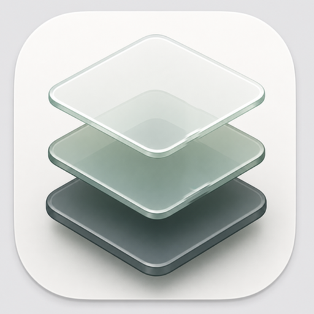

<p align="center">
  
</p>

# Nook for macOS

A quiet, local-first visual workspace for notes, references, and project boards.

Nook keeps your work in folders you choose. No account is required.

## Download

Get the latest macOS build from [Releases](https://github.com/hudsonrivercrossing/Nook.app/releases).

Download both files:

- `Nook_<version>_aarch64.dmg`
- `Nook_<version>_aarch64.dmg.sha256`

Optional checksum check:

```sh
shasum -a 256 -c Nook_<version>_aarch64.dmg.sha256
```

## Install

1. Open the DMG.
2. Drag `Nook.app` into `Applications`.
3. Open `Nook.app`.
4. If macOS blocks the first launch, open System Settings > Privacy & Security, then choose Open Anyway.

Nook is currently an unsigned community build. Install it only from this release repo.

## Updates

This repo also hosts the public updater files used by Nook for future in-app updates.

Source code and updater private keys are not stored here.
