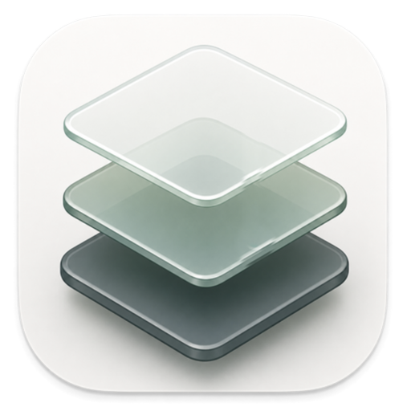

<p align="center">
  
</p>

# Nook

一处安静的地方，留给少数重要的项目。
A calm place for the few projects that matter.

[Website](https://hudsonrivercrossing.github.io/Nook.app/) · [Download for Mac](https://github.com/hudsonrivercrossing/Nook.app/releases/latest/download/Nook.dmg)

Mac 上的白板：把链接、图片和文字放在一起，用区域和箭头理清楚。白板是你所选文件夹里的普通文件，不需要账号，不收集任何数据。

Boards for your Mac: links, images and notes side by side, sorted with regions and arrows. Your boards are plain files in a folder you choose. No account, no data collected.

macOS 15 or later · Apple silicon and Intel

## 安装 · Install

1. 下载并打开 `Nook.dmg`，把 Nook 拖进「应用程序」。
   Download and open `Nook.dmg`, then drag Nook into Applications.
2. Nook 没有经过 Apple 公证，第一次打开时 macOS 会拦下它。打开「系统设置 › 隐私与安全性」，在「安全性」里点「仍要打开」，然后按提示确认。
   Nook isn't notarized by Apple, so macOS stops it the first time. Open System Settings › Privacy & Security, click Open Anyway under Security, then confirm when asked.
3. 更新时，下载新的 DMG，把 Nook 拖进「应用程序」替换旧的。你的白板不受影响。
   To update, download the new DMG and drag Nook into Applications to replace the old one. Your boards aren't touched.

核对下载 · Check the download:

```sh
shasum -a 256 -c Nook.dmg.sha256
```
